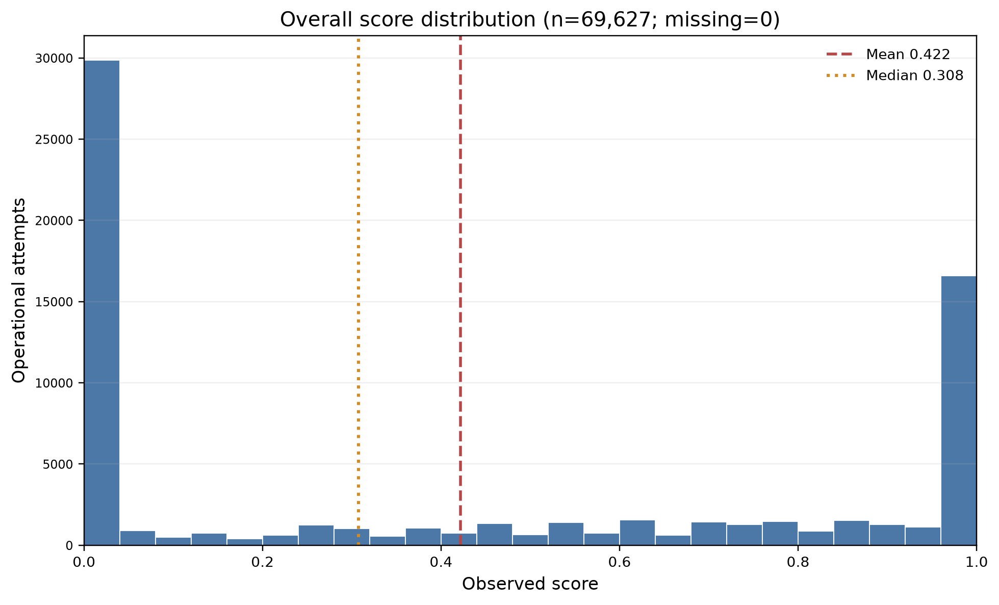
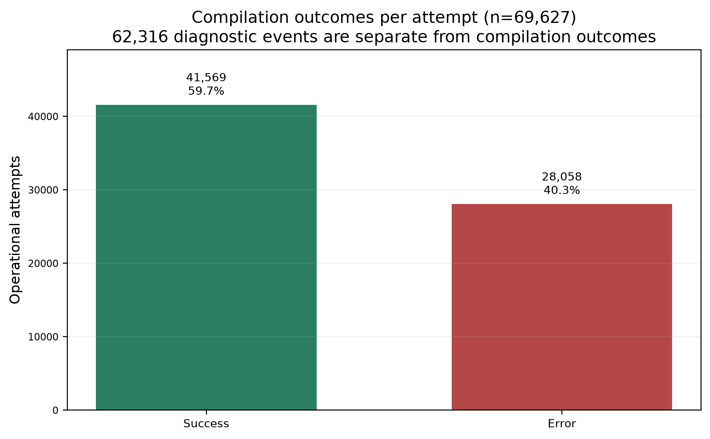
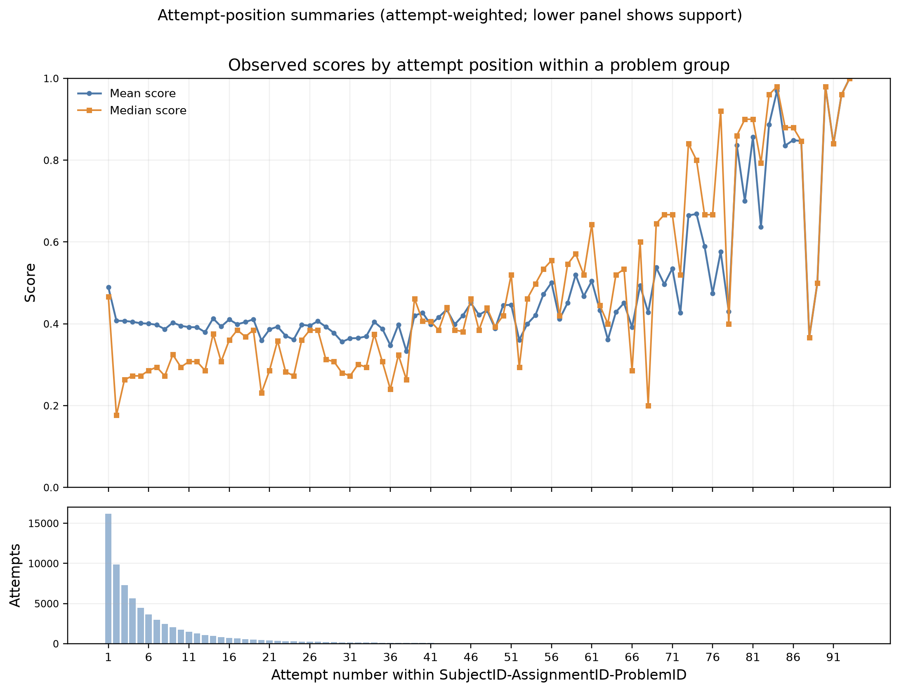
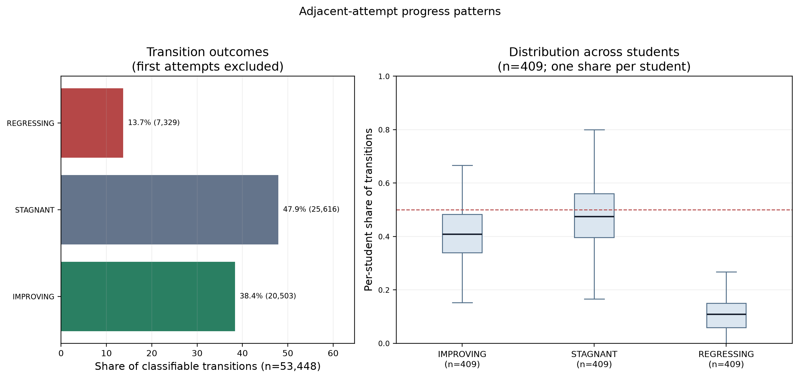
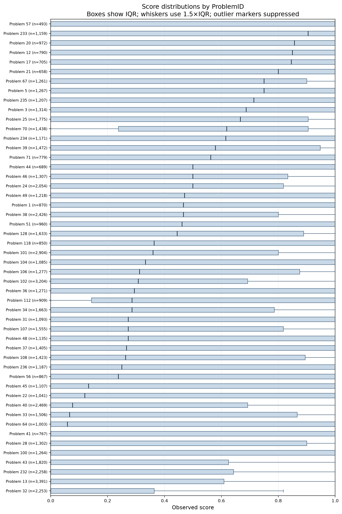
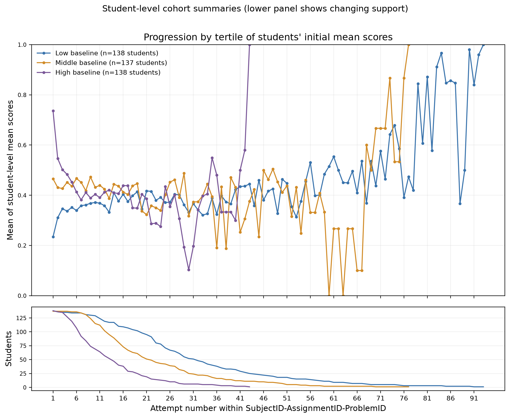

# Stage 3: Historical exploratory data analysis

## Scope and analysis units

This report analyzes the approved Stage 2 output in
`analysis/outputs/reconstructed_attempts.csv`. The EDA script checks the Stage
2 validation summary and saved-output checks before analysis; it does not rerun
attempt reconstruction. It analyzes all **69,627 operational attempts** from
**413 students**, **50 ProblemIDs**, and **16,179
student-assignment-problem groups**. The original dataset and application code
are not modified.

Scores are analyzed as recorded on Run.Program attempts. Missing scores remain
missing and are reported; this release has none. Score standard deviation is
the sample standard deviation (`ddof=1`); quartiles use linear empirical
quantiles.

Compilation percentages use all 69,627 attempts as their denominator.
Diagnostic rows are counted separately from attempts and compilation
outcomes. Progress percentages use only score-classifiable transitions from
attempt 2 onward; the first attempt in each group is excluded. Attempt-position
score summaries pool attempts and are descriptive, not independent-student
estimates. Per-student transition shares and baseline-cohort progression give
each student one contribution per summary position.

## Findings

### Overall score distribution

| Statistic | Value |
|---|---:|
| Attempts with observed scores | 69,627 |
| Missing attempt scores | 0 |
| Mean | 0.4216 |
| Median | 0.3077 |
| Sample standard deviation | 0.4281 |
| 25th percentile | 0.0000 |
| 75th percentile | 0.9231 |
| Minimum / maximum | 0.0000 / 1.0000 |

The score distribution is broad, with a large concentration at zero and
substantial mass near the upper end. The mean is higher than the median, while
the interquartile range spans nearly the full score scale. These are
attempt-level observations; the distribution does not establish a pass
threshold or a learning effect.



### Compilation outcomes and diagnostics

| Compile outcome | Attempts | Percent of all attempts | Diagnostic events |
|---|---:|---:|---:|
| Success | 41,569 | 59.70% | 0 |
| Error | 28,058 | 40.30% | 62,316 |

The outcome denominator is 69,627 attempts. The **62,316 diagnostic events**
are not failed attempts: they are attached to the 28,058 error-outcome Compile
events, averaging about 2.22 diagnostics per failed compilation. Every failed
Compile has at least one diagnostic in this release.



### Submission behavior

Attempts per student (413 students) had a mean of **168.6**, median **145**,
interquartile range **77-235**, and range **1-1,116**. The mean exceeding the
median and the maximum indicate a long right tail in attempt volume.

Attempts per ProblemID (50 problems) had a mean of **1,392.5**, median
**1,262.5**, interquartile range **979.75-1,542.75**, and range **493-3,391**.
The most attempted problems were ProblemID 13 (3,391 attempts), 102 (3,204),
101 (2,904), 40 (2,469), and 38 (2,426). ProblemID 57 had the fewest observed
attempts (493).

These are counts of operational Run.Program attempts, not counts of unique
students per attempt or measures of time spent.

### Score by attempt position

Attempt position is the sequence within a student-assignment-problem group,
ordered by the verified `Order` field.

| Attempt position | Attempts | Students represented | Mean score | Median score |
|---:|---:|---:|---:|---:|
| 1 | 16,179 | 413 | 0.4894 | 0.4667 |
| 2 | 9,866 | 409 | 0.4074 | 0.1765 |
| 10 | 1,749 | 313 | 0.3950 | 0.2941 |
| 20 | 450 | 174 | 0.3594 | 0.2308 |
| 93 | 1 | 1 | 1.0000 | 1.0000 |

There are 93 observed attempt positions, but support falls sharply at higher
positions. The lower panel of the figure shows this decline. The high-position
scores are therefore especially unstable. Differences across positions can
reflect which problem groups continue to have attempts, not within-student
change alone; they are not evidence of causal learning or effectiveness.



### Adjacent-attempt progress

There were **53,448 classifiable transitions** after excluding the 16,179 first
attempts. No later transition was unclassifiable due to missing scores in this
release.

| Classification | Transitions | Percent of classifiable transitions |
|---|---:|---:|
| Improving (delta > 0.05) | 20,503 | 38.36% |
| Stagnant (-0.05 <= delta <= 0.05) | 25,616 | 47.93% |
| Regressing (delta < -0.05) | 7,329 | 13.71% |

Four students had no classifiable transition; **409 students** had at least
one. To show variation without treating attempts as independent students,
each of those 409 students contributes one share for each transition type:

| Per-student transition share | Mean share | Median share (IQR) | Students with >50% of transitions |
|---|---:|---:|---:|
| Improving | 41.0% | 40.9% (34.0%-48.3%) | 70 |
| Stagnant | 48.6% | 47.6% (39.6%-56.1%) | 167 |
| Regressing | 10.4% | 10.9% (5.9%-15.1%) | 0 |

The remaining 172 students with transitions did not have a single category
account for more than half of their transitions. This spread shows that the
aggregate transition percentages do not describe every student's pattern.



### Problem-level score differences

ProblemID-level distributions vary substantially. The table shows the five
lowest and highest mean observed scores; `n` is the number of attempt rows,
with distinct students shown separately.

| Lower-mean ProblemID | Attempts | Students | Mean | Median |
|---|---:|---:|---:|---:|
| 32 | 2,253 | 333 | 0.2251 | 0.0000 |
| 13 | 3,391 | 386 | 0.2331 | 0.0000 |
| 232 | 2,258 | 378 | 0.2653 | 0.0000 |
| 43 | 1,820 | 311 | 0.2749 | 0.0000 |
| 100 | 1,264 | 324 | 0.3143 | 0.0000 |

| Higher-mean ProblemID | Attempts | Students | Mean | Median |
|---|---:|---:|---:|---:|
| 57 | 493 | 287 | 0.6168 | 1.0000 |
| 21 | 658 | 315 | 0.6030 | 0.8000 |
| 17 | 705 | 313 | 0.6010 | 0.8462 |
| 20 | 972 | 313 | 0.5974 | 0.8571 |
| 235 | 1,207 | 370 | 0.5847 | 0.7143 |

The boxplot displays all 50 score distributions and labels each with its
attempt count. Outlier markers are suppressed for legibility; no attempt rows
are removed from the numeric summaries. Low or high observed scores are not
interpreted as inherent problem difficulty: problem statements, test coverage,
student composition, and repeated attempts are not controlled here.



### Exploratory grouping by initial score

For each student, the baseline is the mean of their first attempt scores across
their student-assignment-problem groups. Students were split into `qcut`
tertiles of that baseline: **Low** (138 students; upper edge 0.3618), **Middle**
(137; upper edge 0.5757), and **High** (138; upper edge 1.0000). At each
attempt position, each student first contributes their own mean score across
the problem groups where they reached that position; the plotted cohort
statistic then averages those student-level values. The lower panel reports
the number of students supporting each point.

| Baseline group | Mean at position 1 | Mean at position 2 | Students at position 2 | Mean at position 5 | Students at position 5 |
|---|---:|---:|---:|---:|---:|
| Low | 0.2345 | 0.3109 | 136 | 0.3515 | 134 |
| Middle | 0.4654 | 0.4305 | 137 | 0.4361 | 136 |
| High | 0.7363 | 0.5459 | 136 | 0.4527 | 119 |

At position 20 the groups have 98, 55, and 21 students, respectively; at
position 30 they have 52, 25, and 6. The early differences and later
fluctuations are descriptive only. The baseline split is constructed from
initial scores, so regression to the mean, different problem coverage, and
selective continuation are important alternative explanations.



## Methods and reproducibility

Run the analysis from the repository root. The script reads only the approved
attempt and diagnostic outputs, checks that Stage 2 validations passed, and
fails if the attempt count, identifiers, ordering, adjacent-score calculations,
classification thresholds, or diagnostic links do not match.

```powershell
python -m pip install -r analysis\requirements.txt
python analysis\scripts\exploratory_analysis.py
```

The script writes CSV summaries and `eda_summary.json` under
`analysis/outputs/`, and six Matplotlib plots under
`analysis/outputs/plots/`. The dependency versions used were NumPy 2.1.3,
Pandas 2.2.3, and Matplotlib 3.11.2. The original dataset and application
remain untouched.

## Limitations and threats to validity

- The dataset is historical and observational; it cannot evaluate whether
  adaptive AI feedback improves learning.
- A Run.Program row is the approved operational attempt proxy, not independent
  proof of a deliberate submission action.
- Repeated attempts are clustered within students and problem groups. The
  attempt-level summaries and plots are descriptive; no independent-sample
  significance tests are reported.
- Attempt-position samples shrink at larger attempt numbers. Score changes
  across positions can reflect group composition and continuation.
- Problem-level score comparisons are unadjusted for student, assignment, or
  problem characteristics. Problem IDs alone do not establish difficulty.
- Initial-score tertiles are exploratory and especially susceptible to
  regression to the mean and unequal problem coverage.
- Scores measure observed outcomes only. This analysis does not infer time
  spent, algorithmic complexity, or causal learning gains.
